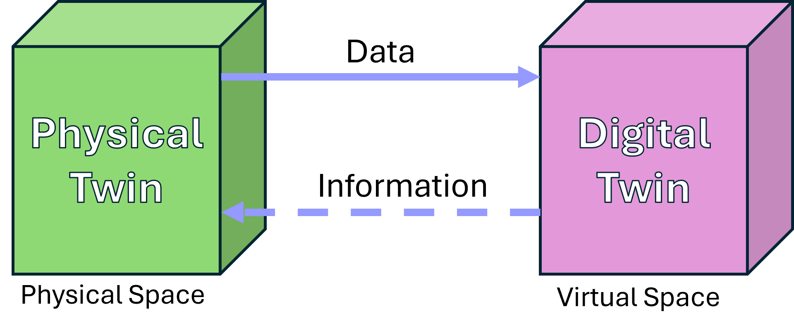

# 3D Gaussian Splatting for Indoor Geospatial Digital Twins


-2D6A4F)


> **Master's Thesis — M.Sc. Applied Geoinformatics**  
> Paris Lodron University of Salzburg (PLUS), Department of Geoinformatics (Z\_GIS)  
> **Author:** Florian Herbst  
> **Interactive 3D Splat Viewer:** [Launch Live 3D Gaussian Splat of the iDEAS:lab](https://bosquo.github.io/e-portfolio/assets/projects/project_1_master_thesis/viewer.html)



---

## Overview

Traditional photogrammetry excels at geometric reconstruction and metric accuracy, yet often struggles to capture the full radiometric complexity, lighting fidelity, and real-time frame rates demanded by interactive digital twins.

This Master's thesis evaluates whether **3D Gaussian Splatting (3DGS)** satisfies the **six core requirements of an indoor geospatial digital twin**:
1. **High visual fidelity**
2. **Metric accuracy**
3. **Real-time interactivity**
4. **Simulation capability** (including "what-if" lighting/brightness scenarios)
5. **Live data integration** (IoT sensor streams mapped directly to Gaussian properties)
6. **Geospatial interoperability**

Through both a systematic literature review and an exploratory practical case study—reconstructing the **Z\_GIS iDEAS:lab** into an interactive digital twin in Unity—3DGS is benchmarked directly against conventional textured photogrammetric meshes.

---

## Methodology & Workflow

1. **Data Acquisition & Automated Frame Selection**
   - Captured indoor panoramic/wide-angle imagery of the Z\_GIS iDEAS:lab using an Insta360 camera, followed by grain removal in Insta360 Studio.
   - Automated frame extraction (`extract_frames.py`) and blur-free quality filtering (`blurr_free_frame_selection.py`) in Python.

2. **Georeferenced Photogrammetry & Coordinate Alignment**
   - Processed filtered imagery in **Agisoft Metashape** (Structure-from-Motion alignment, marker detection, Ground Control Point coordinate assignment, and transformation matrix optimization).
   - Executed custom Python scripts (`calculate_shift_vector.py`, `export_colmap_offset.py`, `export_mesh_offset.py`) to compute bounding-box shift vectors, center coordinates cleanly near `(0, 0, 0)`, and export both a decimated textured `Mesh.obj` and offset COLMAP camera poses.

3. **3D Gaussian Splatting Training**
   - Trained a **2.5-million Gaussian splat model** (`splat.ply`) in **LichtFeld Studio** using the **MRNRF optimizer** over **260,000 iterations** (16 hours training duration, final loss: `0.024`).

4. **Unity Digital Twin & ArcGIS Maps SDK Integration**
   - Built the interactive **Digital Twin iDEAS:lab** application in the **Unity Engine**, integrating:
     - **ArcGIS Maps SDK for Unity** (`Map_Manager.cs`) with basemap, terrain, building, and tree layers;
     - **Gsplat-Renderer Plugin** for real-time Gaussian splat rendering and Gaussian property manipulation;
     - **IoT Data Streaming** (`SenseBoxStreamer.cs`) connecting live SenseBox environmental measurements;
     - **Interactive Simulation & Navigation** (`Billboard.cs`, `RoomPin.cs`, `ThrowPhysicsObjects.cs`) enabling seamless Map-to-FPV transitions and physics/lighting simulation.

---

## Key Results & Conclusions

- **Visual Fidelity & Metric Accuracy:** Compared directly to photogrammetry, 3DGS delivered noticeably higher visual realism and radiometric fidelity without introducing additional metric error.
- **Interactivity, Simulation & Live IoT:** 3DGS supported real-time first-person interactivity, lighting/brightness "what-if" simulation, and direct mapping of live SenseBox IoT values onto splat properties.
- **Geospatial Interoperability:** While ecosystem support (standards, file types, coordinate-offset handling) still requires engineering workarounds, industry adoption is advancing rapidly. Taken together, 3DGS proves highly effective for indoor geospatial digital twins—especially when paired with photogrammetric meshes for collision, geometry, and geospatial referencing.

---

## Tech Stack

- **3D Reconstruction & Rendering:** 3D Gaussian Splatting, LichtFeld Studio (MRNRF), Agisoft Metashape, COLMAP
- **Digital Twin & GIS Engine:** Unity Engine, Esri ArcGIS Maps SDK for Unity, Gsplat-Renderer Plugin
- **Programming & Automation:** Python (`extract_frames.py`, `blurr_free_frame_selection.py`, `calculate_shift_vector.py`, `export_colmap_offset.py`, `export_mesh_offset.py`), C# (`Map_Manager.cs`, `SenseBoxStreamer.cs`, `Billboard.cs`, `RoomPin.cs`, `ThrowPhysicsObjects.cs`)
- **Live Data:** SenseBox IoT streams, ArcGIS web services

---

## Repository Structure

```text
3dgs-indoor-digital-twin/
├── assets/
│   └── cover.png          # Physical Twin ↔ Digital Twin conceptual diagram
├── docs/
│   └── report.pdf         # Thesis abstract, Metashape/LichtFeld/Unity workflows, and conclusions
├── .gitignore
└── README.md
```

- **Report & Workflow Diagrams:** [`docs/report.pdf`](docs/report.pdf)
- **Live Interactive 3D Splat (2.5M Gaussians):** [Open Viewer in Browser](https://bosquo.github.io/e-portfolio/assets/projects/project_1_master_thesis/viewer.html) *(hosted via the portfolio due to the 35.7 MB `.sog` asset)*

---

<p align="center">
  Part of the <a href="https://bosquo.github.io/e-portfolio/"><strong>Florian Herbst — Geoinformatics &amp; Forestry e-Portfolio</strong></a>
</p>
